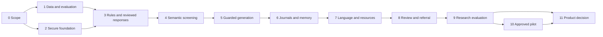

# Lumen: phase-by-phase implementation plan

Planning baseline: **8 October 2026**. Root: `D:\Cooking stuff\Lumen`.

This is a research-to-product plan for the project described in the supplied proposal and slides. It does not authorize a public clinical deployment or establish clinical effectiveness. Before planning, the workspace contained documentation and papers and its dataset directory was empty. Implementation has since begun; see the [task-by-task audit](docs/PLAN_AUDIT.md) and [status record](docs/IMPLEMENTATION_STATUS.md) for actual progress and uncompleted gates.

## Intended outcome

Build an adult emotional-support companion with chat and optional journaling, a shared independently controlled safety pipeline, English/Hindi/Marathi and code-mixed qualification, consented contextual memory, optional mood views, whole-response guardrails, understandable decisions, and verified local support choices. Develop evidence that demonstrates where the system works, where it fails, and whether the proposed temporal approach improves appropriate action at a manageable false-alert rate.

The main research hypothesis is **incremental benefit from consented recent and cross-source temporal evidence on indirect multilingual distress**, not invention of RAG, multilingual chat, journal analysis, or an independent safety layer. Current products already overlap with the broad feature set. See [the market review](docs/research/MARKET_AND_NOVELTY.md) before using a novelty claim in an academic submission or pitch.

## Delivery assumptions

- Four contributors, approximately 8–12 focused hours each per week: an estimated 32–48 team hours/week. Availability, skills and assignments are not yet confirmed.
- One clinician/clinical collaborator and qualified Hindi/Marathi reviewers must be arranged. They are external dependencies, not assumed volunteers.
- Windows/16 GB development environment from the proposal; hosted generation is a candidate, subject to privacy and cost review. No local GPU is assumed.
- Text-first web delivery; no foundation-model training and no compulsory native app, voice or wearables.
- Relative weeks begin after the team agrees to start implementation. Historic July/September 2026 slides do not establish the present build schedule.
- Work can overlap where dependencies allow, but exit gates cannot be skipped to meet a demonstration date.

The baseline reaches a guarded single-turn prototype around Week 18, a complete offline research prototype around Weeks 26–30, and a conditional supervised pilot/product decision around Weeks 34–38. This is approximately nine months at the assumed part-time pace. Ethics, clinical staffing and procurement can extend it; a completed academic prototype can be delivered while those product dependencies remain open.

## Phase map

**Progress checked 8 October 2026:** research/data engineering, accounts/storage and the shared draft rule path are tested. Journal editing, optional self-reported mood and a 14-day view are implemented as an independent Phase 6 slice. An account-independent India resource directory has dated official sources and expiry controls. Reviewed guidance and independent language judgments remain the next human-review deliverable; [the assignable review packet](docs/review/REVIEW_PACKET.md) is ready. AI/provider integration is deferred at the owner's request. Each phase retains its full exit dependencies; [every task and requirement is cross-checked here](docs/PLAN_AUDIT.md).

| Phase | Relative weeks | Main outcome | Depends on |
| --- | --- | --- | --- |
| 0 | 1–2 | Accepted scope, intended use, clinical/data responsibilities | This research pack |
| 1 | 3–6; annotation continues later | Licensed data inventory, annotation rubric, frozen evaluation design | 0 |
| 2 | 5–7 | Secure web/API/database foundation | 0; initial data contracts from 1 |
| 3 | 8–10 | Shared multilingual rule baseline and reviewed guidance | 1, 2 |
| 4 | 11–14 | Independently evaluated semantic screening | 1, 3 |
| 5 | 15–18 | Guarded generation and complete text response flow | 3, 4 |
| 6 | 19–21 | Optional journals, bounded memory and mood trends | 2, 3, 5 |
| 7 | 22–24 | Language qualification and verified regional resources | 1, 4, 5, 6 |
| 8 | 25–26 | Reviewer workflow and honest referral operations | 6, 7 |
| 9 | 27–30 | Frozen ablations, safety testing and reproducible evidence | 1–8 |
| 10 | 31–34+ | Approved supervised feasibility pilot | 9; ethics, staffing and partner gates |
| 11 | 35–38+ | Product/market decision and staged release hardening | 9; pilot results if a pilot is approved |

## Phase 0 — Scope, clinical responsibilities and feasibility

**Goal:** turn the documents into a single intended-use specification and resolve choices that would otherwise cause unsafe implementation.

Tasks:

1. Confirm adult-only initial scope, intended users, first languages/scripts, journal processing timing, and institutional discovery segment.
2. Review the corrected literature/competitor claims with the guide. Preserve originals; create revised future proposal/deck text only when needed.
3. Assign clinical policy ownership, bilingual annotation ownership, security/data ownership and development ownership. Define how unresolved clinical questions reach the collaborator.
4. Specify permissible support, prohibited clinical claims, action tiers, uncertainty behavior and the absence of automatic emergency dispatch.
5. Inventory data flow to hosted providers, storage, reviewers and partners. Draft consent boundaries and retention/deletion rules.
6. Establish whether the institution requires ethics review for planned data collection, usability tasks or pilot; record the determination, not an assumed exemption.
7. Set an initial budget ceiling and reviewer-time allocation; assess the laptop and hosting options without buying hardware or models unnecessarily.

**Deliverables:** intended-use statement; requirement checklist R01–R12; named responsibilities; consent/data-flow draft; clinical review questions; dated risk register; approved research protocol scope.

**Exit:** scope is internally consistent, clinical/data responsibilities are named, and there is a lawful/ethical route to the proposed evaluation. Until then, reviewer-written offline scenarios may proceed within their approved scope; personal-data collection and public support claims do not.

## Phase 1 — Data provenance, rubric and reproducible baselines

**Goal:** build a testable research foundation before selecting models by headline accuracy.

Tasks:

1. Create a dataset registry with exact revisions, owners, permissions, licenses, allowed derivatives, clinical status, languages and personal-data risk. Separate training, support-content retrieval and evaluation assets.
2. Resolve restrictions before acquiring or translating a corpus. The supplied papers are not evidence that their datasets are available for commercial reuse.
3. Create the 40–60-family annotation pilot from [the evaluation plan](docs/EVALUATION_PLAN.md). Include indirect concerns, negation, quoted/third-person speech, idioms, code mixing, benign distress and old disclosures.
4. Obtain independent bilingual annotations and clinical adjudication for high-concern/disputed cases; record agreement and uncertainty.
5. Split by person/trajectory/source/scenario family and keep translations/paraphrases together. Freeze a held-out set before prompt optimization or model training; keep the final blinded qualification set inaccessible to implementation tuning until Phase 9. Use development fixtures and separately declared interim validation sets for earlier phases.
6. Implement the smallest evaluator: load approved cases; run a versioned configuration; report action metrics, false-alert burden, severe response failures and latency; save per-case evidence and split hashes.
7. Stage annotation from prototype to qualification sizes as reviewer capacity allows. Lock targets and failure definitions prospectively.

**Deliverables:** dataset registry; annotation handbook; consent/permission records where applicable; development and inaccessible-to-tuning test manifests; baseline run command; reproducible output schema.

**Exit:** licenses are clear for each intended use, rubric disagreements are documented, no known family/translation leakage exists, and one baseline run is reproducible. An unavailable clinical corpus is reported as unavailable; synthetic examples are never relabeled as clinical observations.

## Phase 2 — Secure project and data foundation

**Current progress:** the local synthetic-data web/API/PostgreSQL vertical slice is implemented and tested. See [status and remaining exit gates](docs/IMPLEMENTATION_STATUS.md) and [reproduction commands](docs/LOCAL_DEVELOPMENT.md). Hosted CI/deployment operations and personal-data release gates remain open.

**Goal:** create one usable repository and secure boundaries that later safety features can share.

Create `apps/web`, `services/api`, `evaluation`, and `policies` under this Lumen root. Keep supplied source documents where they are. Add only the implementation files required by the first vertical slice.

Tasks:

1. Pin supported Node/Python/framework/database versions and dependency lockfiles. Select one package manager and document Windows setup.
2. Create the responsive accessible app shell and FastAPI service. Connect PostgreSQL through one migration workflow.
3. Implement authentication, secure sessions, server-side authorization, user ownership, consent revisions and an adult eligibility flow; use established libraries/provider features rather than custom cryptography or password handling.
4. Introduce a shared input-event schema, source IDs, server ordering, idempotency keys and explicit save status.
5. Configure secret management, HTTPS in deployed environments, appropriate CSRF protection, input/request limits, restricted logging and database roles.
6. Implement initial export, deletion/tombstones, consent withdrawal and cross-user isolation checks before storing participant material.
7. Add CI for build/type checks, meaningful safety/security tests and dependency review. Run the applicable dependency audit before future commits; inspect diffs before pushing.

**Deliverables:** local synthetic-data vertical slice; migrations; environment example without credentials; setup guide; access/ownership tests; deletion/export smoke checks; protected staging environment if needed.

**Exit:** two test users cannot access each other's content or retrieval records; unauthorized reviewers are denied; deletion and consent changes are enforced; no secret or raw mental-health text is in ordinary logs. No open-ended generative companion is released at this phase.

## Phase 3 — Shared rule baseline and reliable reviewed guidance

**Current progress:** chat and journal submissions use the same versioned draft baseline, with normalized evidence spans, strict uncertainty/unavailability, retained-decision retries and consent-bound deletion. API/database/browser regressions cover faults and stale-response privacy. Clinical/bilingual policy review, supportive templates and verified-resource routing are pending; see [the3.1–3.7 audit](docs/PLAN_AUDIT.md#phases-03-task-by-task-cross-check). This engineering milestone does not pass the reviewed-guidance exit gate.

**Goal:** ship the first small complete safety path using understandable rules and reviewed language.

Tasks:

1. Implement one shared submission path for chat and journal sources. Preserve original text and script while applying conservative normalization.
2. Build versioned English/Hindi/Marathi and Romanized lexicons with bilingual review. Avoid substring-only triggers; test negation, idioms, third-person references and quotation.
3. Add operational action tiers and separate uncertain/unavailable status. Use a reviewed decision table rather than an arbitrary numeric risk sum.
4. Write clinician-reviewed supportive/clarification templates in the intended languages and a provisional verified-resource registry.
5. Route immediate concerns to reviewed guidance without waiting for vector search or generation.
6. Record evidence spans, rule IDs and versioned decisions without exposing a “suicide probability” to the user.
7. Test every route, retries, simultaneous chat/journal submission and database failure. Add an always-available support entry point and accessible dismissible cards.

**Deliverables:** versioned rule/policy files; reviewed templates; shared safety endpoint; first error analysis; cross-source consistency tests.

**Exit:** known explicit-concern sentinel cases route appropriately across sources; benign edge cases and language limitations are documented; faults never become a silent Low result. Rules are the measured baseline, not a claimed solution to implicit risk.

## Phase 4 — Independent semantic screening

**Goal:** determine whether one semantic detector adds value to rules under the actual language, privacy and latency constraints.

Tasks:

1. Compare a small number of candidates: a prompt-defined detector and, only if licensed data support it, a lightweight supervised classifier. Keep the conversation generator separate.
2. Enforce structured output/schema validation, versioned prompts and bounded recent context; include uncertainty/disagreement.
3. Run current-message and recent-dialogue variants using the same test design. Assess explicit versus indirect cases and every language slice.
4. Tune only on development data; compare recall at matched false-alert burden and validate proposed thresholds with the clinician.
5. Test prompt injection, invalid outputs, timeouts, provider failure and multilingual drift. Retain a reviewed degraded path.
6. Consider emotion/stress scoring only as an ablation with a relevant measurable benefit. Do not add a model because the deck names an algorithm family.

**Deliverables:** detector selection record; measured model/provider cost and latency; configuration hashes; graded development/interim-validation error analysis; operating-policy draft. The final blinded qualification report belongs to Phase 9.

**Exit:** improvement or lack of improvement over the rules baseline is quantified. Select the smallest candidate that meets the provisional gates. If none qualifies, retain a constrained engineering prototype and narrow claims instead of stacking unvalidated models.

## Phase 5 — Guarded generation and text-support experience

**Goal:** connect ordinary supportive conversation to the safety path without letting generation bypass it.

Tasks:

1. Choose one generator through a language/safety/cost evaluation and processor-terms review; record exact model revision and privacy conditions.
2. Define scope, tone, limits and reviewed actions in system prompts; keep retrieved/user material as untrusted data.
3. Implement completed-draft output validation for diagnosis, medical advice, harmful instructions, delusion affirmation, stigma, dependence, false promises, impersonation and fabricated services.
4. Implement bounded retry/regeneration only if measured latency permits; otherwise use reviewed fallback. No unvalidated streaming or audio.
5. Build the complete chat interface, explanation text, feedback and verified-resource display. Do not make claims about a human watching unless that operation exists.
6. Test multilingual ordinary-support examples as well as adversarial and evolving-risk conversations. Test detector/generator disagreement and outage.

**Deliverables:** guarded text-chat prototype; output policy and response-quality rubric; red-team fixtures; human-reviewed response examples; component latency report.

**Exit:** no unresolved severe unsafe output in the reviewed release suite, fallback is demonstrated, and ordinary support remains usable. This is the first guarded generation milestone; clinical effectiveness remains untested.

## Phase 6 — Optional journals, context and mood patterns

**Goal:** integrate the project's distinctive temporal research inputs with user control and honest interpretation.

Tasks:

1. Add journal create/edit/delete and optional mood entries. Route submitted/edited journals through the same safety function as chat.
2. Add chronological recent context first; add scoped pgvector retrieval only after a measured need. Keep personal memory separate from general-support content.
3. Preserve source/time provenance, active consent and deletion status before retrieval. Handle old journal uploads and summaries as historical evidence.
4. Provide independent storage/memory controls, export and deletion of content/vectors/summaries/caches. Recheck tombstones in background jobs.
5. Build self-reported mood views with missing observations shown as gaps. Add gentle, opt-in trend check-ins with cooldowns; sentiment and missed visits alone cannot create a Critical state.
6. Create improving, worsening and mixed chat/journal trajectories for the temporal ablation. Test concurrency, memory corrections, withdrawal and deleted-context resurrection.

**Deliverables:** shared journal safety path; memory provenance/consent controls; mood view; temporal fixture set; privacy regression evidence.

**Exit:** cross-user reads are denied on the actual query path in the required isolation tests, withdrawal/deletion tests show no retrieval or recreation, and temporal evidence is available for a controlled comparison. A functioning timeline alone does not prove better risk detection.

## Phase 7 — Language qualification and regional resource integrity

**Goal:** earn every supported language claim and make support choices locally useful.

Tasks:

1. Complete independent review and testing for English, Devanagari Hindi/Marathi, Romanized Hindi/Hinglish and Romanized Marathi/code mixing.
2. Check direct-language screening against any translation-assisted path; retain original input and measure safety loss introduced by translation.
3. Review generation, clarification, crisis guidance and explanations for language quality and cultural fit, not just word-level matching.
4. Verify service registry contacts, sources, jurisdiction, eligibility, language, opening hours and review deadlines; include campus options only after confirmation.
5. Implement locale selection and supported/unsupported-language behavior. Do not infer country from language or pretend a known service is open without registry evidence.
6. Test stale entries, missing location, resource outages and narrow/slow/shared-device use.

**Deliverables:** per-slice scorecards; reviewed language resources; operational registry and maintenance owner; expiry tests; accessible multilingual UI.

**Exit:** reviewed development/interim-validation results support the candidate language scope, with any weak slices narrowed. Final advertised qualification remains subject to Phase 9's blinded gates. A translated interface is not multilingual safety qualification. A telephone link is not a Tele-MANAS backend integration.

## Phase 8 — Reviewer workflow and referral operations

**Goal:** make improvement and any human-support promises operationally honest.

Tasks:

1. Create a restricted reviewer dashboard with decision reasons, source provenance, uncertainty, policy/model versions and a purpose-limited review set.
2. Prefer synthetic/redacted examples during development; use real content only under an approved review basis and clear disclosure.
3. Capture adjudication, false positives/negatives, suggested changes and disagreement. Require reviewed versioned releases and rollback rather than live automatic learning.
4. If a partner is willing, define consented handoff request/acknowledgment states, coverage hours, responsible staff, response expectations and incident handling. Otherwise provide resource routing only.
5. Give institutions aggregate service information without identifiable journals or individual student risk rankings.
6. Define incident triage, safety-feature disablement, resource corrections and notification responsibilities.

**Deliverables:** reviewer workflow; role/access tests; policy release checklist; partner service description if actually agreed; incident and coverage procedures.

**Exit:** an authorized review can be traced, an unauthorized review is denied, policy changes are regression tested, and every stated human-service capability matches actual coverage. No autonomous family/police/campus notification.

## Phase 9 — Frozen research evaluation and engineering hardening

**Goal:** prove or reject the differentiator and produce reviewable academic evidence.

Tasks:

1. Freeze the configuration, datasets and primary endpoints. Open the final blinded set only now and run rules, semantic, recent-context, cross-source temporal and output-control ablations. After a failure is inspected, that set becomes regression material; use a new untouched holdout for any renewed confirmatory claim, with its required annotation work scheduled explicitly.
2. Report confidence intervals, per-language/category results, missed/over-escalated episodes, first appropriate action, false urgent alert burden and unavailable decisions.
3. Use human-reviewed response safety; calibrate automatic judges against those ratings. Semantic similarity cannot replace that review.
4. Test multi-turn boundary drift, adversarial instructions, edits, ordering, outages, expired resources, export/deletion and authorization.
5. Measure component and total latency on the actual hardware/provider and declared concurrency; record cost per submitted event and rejected/retried calls.
6. Conduct accessibility and low-bandwidth usability tasks with approved scope. Close severe defects before considering participants.
7. Build the academic package: literature matrix; revised gap statements; methodology; use-case/class/sequence diagrams; architecture; GUI; timeline/WBS; limitations; reproducible runs; LaTeX white book and official-format presentations/logbook.

**Deliverables:** frozen benchmark report; ablation table; failure analysis; safety/security/latency checks; reproducibility instructions; academic evidence pack.

**Exit:** all applicable [evaluation gates](docs/EVALUATION_PLAN.md) pass. If temporal fusion has no benefit, remove that safety claim and publish the negative result. The academic project can still contribute a careful benchmark and implementation; product launch is a separate decision.

## Phase 10 — Conditional supervised feasibility pilot

**Goal:** study understanding, usability, appropriate support and operations under the approved human-study boundary.

Tasks:

1. Obtain the applicable ethics/clinical decision, participant materials, consent, withdrawal process, staffing and partner procedures before recruitment.
2. A starting design to review is 30–50 adults for 4–6 weeks; the clinical/ethics team determines final design, sample and criteria. The phase may exceed four calendar weeks.
3. Explain actual availability, information handling, review arrangements, limits and alternatives. Avoid enrolling through coercive grading/employment relationships.
4. Record false-alert burden, reported usability, consent comprehension, resource use, consented handoff completion, outages and adverse events.
5. Predeclare pause/stop conditions for severe unsafe output, data disclosure, failed promised handoff and clinically important adverse events; assign independent review.
6. Do not claim suicide prevention, diagnosis or treatment effectiveness from this feasibility sample. Use a separate adequately designed clinical study for any future efficacy claim.

**Deliverables:** approved protocol; actual participant/attrition accounting; incident/adverse-event report; usability and operational outcomes; revised limitations and go/no-go decision.

**Exit:** pilot oversight signs off on its outcomes and unresolved incidents. Without the necessary approvals or staffing, this phase remains deferred while offline academic work continues; no substitute “public beta” exposes vulnerable users to bypass the gate.

## Phase 11 — Market validation, release and long-term maintenance

**Goal:** decide whether to make a product and define a sustainable service, based on actual evidence.

Tasks:

1. Validate the campus-support hypothesis through approved interviews and prototype tasks with adult users, counselors and budget owners; research-only discovery need not wait for Week 35, but external outreach is not performed by this planning pass.
2. Compare the practical workflow against current alternatives, including nearby Indian products, rather than relying on old chatbot screenshots.
3. Obtain concrete buyer requirements and willingness to pay; distinguish a letter of interest from an operating contract and observed usage from a forecast.
4. Build a bottom-up revenue/cost model using measured utilization, current provider quotes, actual staffing costs and expected adoption. Verify brand/trademark conflicts before commercial naming.
5. Commission the appropriate legal/device-classification and privacy review for the actual intended use, claims and jurisdiction. A “not a doctor” disclaimer alone does not settle regulatory status.
6. Harden backup recovery, retention expiry, deletion on restore, incident response, abuse controls, provider changes, policy releases and rollback. Keep verified support resources accessible when ordinary conversation quotas are exhausted.
7. Release to a limited cohort with explicit supported scope, clear service hours and monitored regressions. Broaden only after the evidence and operating capacity justify it.

**Deliverables:** commercial decision; measured unit economics; privacy/intended-use review; maintenance owners and runbooks; bounded release plan; support continuity/closure plan.

**Exit:** demand, differentiation, safety, operations and economics are each credible. If buyers do not value the tested difference, pivot to a reproducible evaluation toolkit or institution-specific workflow only if the evidence supports that need. Do not add features to compensate for absent demand.

## Requirement-to-phase traceability

The full behavior and acceptance evidence for each requirement are in [the project brief](docs/PROJECT_BRIEF.md). Every implementation task should reference its requirement and phase.

| Requirement | First implementation | Qualification / completion |
| --- | --- | --- |
| R01 Shared input safety | 2–3; journal UI in 6 | Cross-route and concurrency checks in 9 |
| R02 Independent detector | 3–4 | Outage and comparative screening checks in 9 |
| R03 Multilingual coverage | 1, 3–4; complete candidate scope in 7 | Separate blinded language gates in 9 |
| R04 Contextual signals | 4 and 6 | Recent/contextual/temporal ablations in 9 |
| R05 Safe generation | 5 | Whole-response and boundary-drift suite in 9 |
| R06 Support routing | 3, 7–8 | Registry integrity in 9; staffed handoff only after partner gate |
| R07 Journals and mood | 6 | Usability, source provenance and old-entry handling in 9 |
| R08 Explainable decisions | 3, 5 and 8 | Faithful evidence and role-limited reviewer access in 9 |
| R09 Privacy and agency | 0, 2 and 6 | Isolation, withdrawal, delayed-release and deletion tests in 9 |
| R10 Reviewed improvement | 8 | Versioned regression/rollback process in 9 and 11 |
| R11 Reliability | 2–7 | Fault, ordering and latency tests in 9; operational recovery in 11 |
| R12 Demonstrable engineering | 1 onward | Reproducible academic evidence in 9; conditional pilot evidence in 10 |

## Ownership model

These are responsibilities to assign, not claims about individual members' preferences.

| Owner | Main responsibility | Shared review |
| --- | --- | --- |
| Contributor A | Accessible web UI, language controls, journals and user agency | Safety/privacy acceptance with B/D |
| Contributor B | API, database, authorization, consent, deletion and reliability | Data governance with D |
| Contributor C | Rules, detector experiments, generation controls and evaluation code | Clinical decisions with collaborator |
| Contributor D | Literature/data registry, benchmark coordination, evidence and academic documentation | Bilingual/clinical reviewers; market discovery |
| Clinical collaborator | Taxonomy, escalation wording, annotation adjudication, study/incident protocol | Team cannot self-certify clinical validity |
| Hindi/Marathi reviewers | Idioms, Romanization, annotation and response quality | Clinical safety and dataset lead |

Review changes at the shared contract, especially input ordering, context retrieval, policy release and deletion. One end-to-end vertical slice precedes parallel feature expansion.

## Cost and capacity model

No supplier price or project budget has been accepted. Use measured calls and current quotes when implementation starts.

Illustrative utilization assumption: 300 monthly active users × 20 submitted events/week × 4 weeks = 24,000 events/month. If the average event includes detector, generation and output-validation calls, count every call and retry; caching a user's private response across users is prohibited. Compute monthly inference cost as the sum, for each model, of `input tokens × input price + output tokens × output price`, with the vendor's actual billing units. Add database/storage, backups, monitoring, reviewer time, bilingual annotation, hosting, legal/ethics work and human-service staffing. This scenario is arithmetic, not a traction forecast.

Measure p95 cost/latency by event type. Keep token/context budgets bounded. A 16 GB laptop can host development and some CPU experiments; acceptable production latency is unverified. Do not buy a GPU before candidate tests demonstrate a need. Do not describe a free AI app as a free 24-hour human crisis service.

## Backlog priority and deferred extensions

**P0:** intended use; permissions; shared input policy; reviewed guidance; auth/isolation; uncertainty/failure behavior; deletion; frozen evaluation.

**P1:** independently evaluated semantic detection; guarded generation; journals; consented memory; per-language qualification; resource verification; reviewer workflow and reproducible ablations.

**P2 after evidence:** voice input/output, native mobile packaging, multilingual expansion, institution integrations and trained detectors. Voice must confirm a transcript before safety analysis and speak only validated output; measure recognition errors and permission/browser differences. A browser Web Speech API is not a guaranteed private or offline implementation.

**Only after demonstrated need:** a separate queue/Redis, multiple model routing, large fine-tuning, more elaborate analytics or a licensed clinical pathway. Keep learning human reviewed. Never optimize retention by promoting emotional dependence.

## Definition of done

A phase is complete only when its behavior is demonstrated by a reproducible run, its required checks pass, its limitations are recorded, and the next phase has the necessary inputs. Every task record should link to a commit, experiment or reviewed artifact; distinguish proposed/implemented/tested/pilot-observed states. At phase end update decisions, evidence, issues and next actions in this repository. Do not mark a phase done solely because its code compiles or its diagram appears in a presentation.

Start implementation with Phase 0 and the Phase 1 rubric/baseline. Preserve the supplied material and use this Lumen directory as the single home for future code, tests, datasets under their controls, documentation and evidence.
