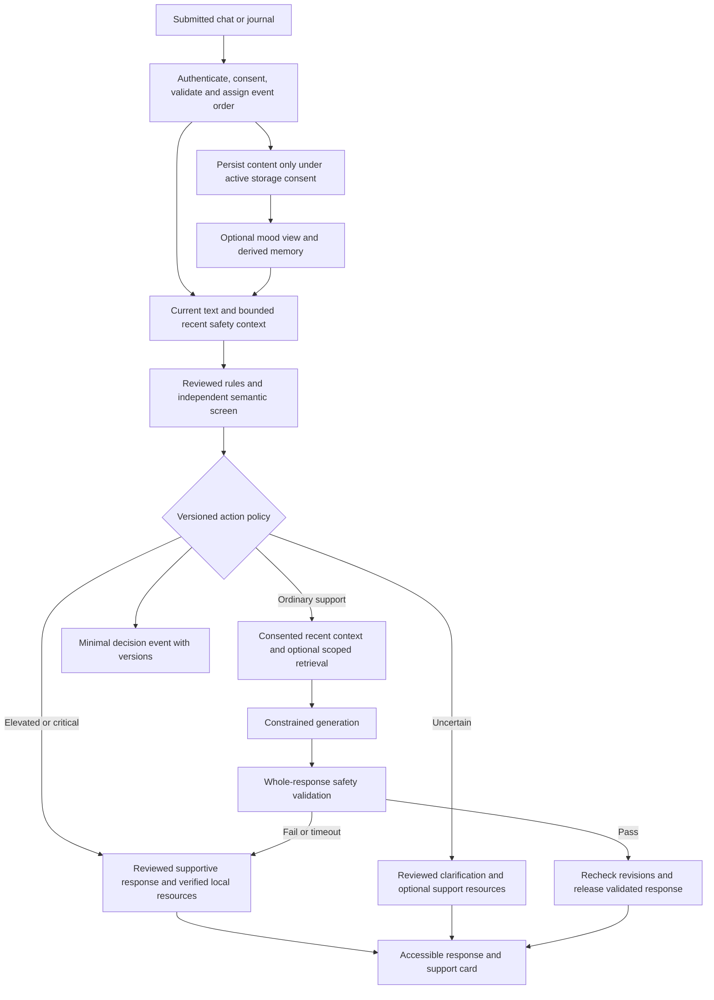

# Architecture and runtime contract

Architecture and staged runtime contract, 8 October 2026. The landing page, web/API/PostgreSQL account/consent/events and shared draft rule checks are implemented locally. Reviewed guidance, semantic screening, generation and memory in the target flow below remain staged future work. The [task audit](PLAN_AUDIT.md) and [implementation status](IMPLEMENTATION_STATUS.md) record actual evidence; [local development](LOCAL_DEVELOPMENT.md) documents the current contracts. Final models and thresholds are selected through [evaluation](EVALUATION_PLAN.md), not by paper leaderboard rank.

## Implemented submission flow

`/` presents Lumen; `/workspace` handles account access, writing, history and privacy. The common authenticated `/events` path validates the account/consent revision and ordering, reuses the versioned offline rule baseline, and commits an explicit receipt. Original text and the validated derived decision are retained together only with saving enabled. Unsaved first responses may show ephemeral checks; retries never rescreen, and withdrawal/deletion remove both text and decisions. Migration0002 adds nullable JSONB with a saved-only retention constraint; old receipts are not backfilled. The service refreshes committed state and the client reconciles fresh receipts/consent before displaying a decision. Evidence uses bounded normalized Unicode-codepoint offsets and policy/baseline hashes, with no probability. Checker faults are unavailable/null action; SQL/native connection faults are sanitized503. No model call, retrieval or reviewed response occurs in this path.

## Smallest credible system

Use one repository, a Next.js web application, a Python FastAPI service for screening and generation orchestration, and PostgreSQL. Add pgvector when semantic memory is implemented. The two languages reflect the supplied frontend and NLP requirements; the API is one service, not a fleet of microservices. Start with one deployed instance and database-backed state. Add Redis or a separate worker only when measured queueing or background work requires it.

Use a currently supported Next.js major and security patch when implementation starts. The live support policy lists 16.x as Active LTS; the proposal's Next.js 14 should not be copied unquestioningly into a new build. Pin runtime and dependency versions in Phase 2. [Next.js support policy](https://nextjs.org/support-policy).

Use Python standard-library Unicode and pattern handling for the initial rules. spaCy/NLTK are not required merely to match a short, reviewed lexicon. Select one embedding candidate and one generator initially. `intfloat/multilingual-e5-small` is a possible CPU-friendly retrieval baseline with an MIT model-card license and required query/passage prefixes; language coverage does not prove Marathi retrieval quality or crisis competence. Benchmark the actual machine before selecting it. [Model card](https://huggingface.co/intfloat/multilingual-e5-small).

Hosted inference is acceptable for prototyping only after processor terms, data retention, regional processing, training-use restrictions and costs are checked. An open-weight model on a 16 GB CPU laptop remains an experiment, not a promised responsive production deployment. Reuse a provider SDK; do not build a general model-routing framework before there is a demonstrated need.

## Runtime flow

The generator is not responsible for deciding whether its own output may bypass safety. Screening is per submitted event and includes the recent dialogue needed to interpret references; semantic search alone must not decide which recent risk disclosures are visible. If reviewed rules already establish an immediate concern and the semantic component fails, retain that action and mark the result degraded. A partial failure must never downgrade an established concern to a generic uncertain path.

For immediate concerns, deliver the reviewed guidance before waiting on optional embeddings or a generator. A minimal operational audit can be recorded alongside this path. If storage fails, display an honest failure to save and retain no false “journal saved” status. The system must still expose the reviewed support path.

## Shared safety contract

All input routes use one policy function. The event carries an immutable ID, source (`chat`, `journal`, later `voice_transcript`), server sequence, submission time, original authored time if different, locale/script, session reference, active consent revision, and validated text. Validation limits text length, request size and request rate. Keep the original language available; normalization or translation must not silently replace it.

The screening result records:

- Recognized concern categories under a clinician-reviewed taxonomy.
- An operational action tier, evidence spans/references, rule IDs, model/prompt version and policy version.
- Uncertainty and availability status, explicitly distinct from “no concern detected.”
- Bounded context IDs actually considered, with age and consent status.
- The applicable response template and resource selection policy.

The four document labels **Low / Moderate / Elevated / Critical** are internal action tiers, not calibrated probabilities, diagnoses, or validated clinical scales. Do not show a percentage “suicide risk.” A separate `safety_unavailable` or `uncertain` state handles failure or ambiguity.

| Operational tier | Intended system action | Constraint |
| --- | --- | --- |
| Low | Ordinary supportive conversation | Absence of a detected concern is not assurance of safety |
| Moderate | Gentle clarification/check-in and optional support | Sadness, low mood and unclear metaphors do not automatically require emergency action |
| Elevated | Reviewed supportive guidance and prominent professional-support choices | Maintain user agency; do not provide unrestricted generative advice |
| Critical | Immediate reviewed guidance appropriate to a potentially immediate safety concern | Do not wait for retrieval; do not imply a human responder or dispatch service exists |
| Uncertain/unavailable | Acknowledge limitations, ask a short reviewed clarification when appropriate, keep resources available | Never coerce the result to Low or silently report successful screening |

Use a decision table, not an arbitrary weighted “risk score.” An explicit immediate concern cannot be averaged away by a positive emotion score. Self-reported mood and inferred emotion are supportive context signals with different provenance. Adding multiple noisy models does not automatically improve safety.

A user correction must be acknowledged and considered; it is neither ignored forever nor a magic override for explicit current danger. Define resolution, expiry and repeated-alert behavior with a clinician. State changes use server ordering and a transaction or compare-and-set revision so concurrent chat/journal events cannot silently overwrite a newer state. Journal authored time is not interchangeable with submission time: a newly uploaded old entry should invite clarification about current wellbeing, not be represented as a present emergency automatically.

## Context and memory

**Current engineering slice:** voluntary journal mood is an optional integer1–5 retained under the same saving consent as its journal. Editing uses consent/content revisions, rescreens through the shared rule path and preserves original submission/source provenance. Withdrawal/deletion clears text, checks and mood together. The14-day view shows the latest self-report on each local-calendar submission day and gaps for missing observations; no personal retrieval, inference, trend check-in or temporal safety state is enabled.

Maintain two distinct stores: (1) the user's optional personal history and (2) reviewed general-support content. Do not mix personal histories into a global counseling retrieval corpus.

Start with recent chronological context. Add similarity retrieval only when it improves a measured task or reduces verified context costs without a safety regression. Retrieval always scopes by authenticated user, active storage/memory consent, visibility, deletion state and bounded time relevance **before** scoring results. Preserve source entry IDs, source types and timestamps. Never equate a model summary with a direct user statement.

Keep a minimal recent safety state independent of vector retrieval; validate retention for this state. A distant semantically similar entry must not displace the immediately preceding message. Do not retrieve other users' histories, stale withdrawn data or a reviewer annotation as if the user wrote it.

User controls distinguish saving content, using saved content for memory, optional authorized human review, and research participation. Turning memory off stops new retrieval; deletion invalidates entries, vectors, summaries, caches and pending derivation jobs. Worker tasks must recheck consent and tombstones before writing, to avoid resurrecting deleted memories. Describe backup expiry and any legally required minimal operational record retention honestly.

Use self-reported mood timelines first. Show inferred emotion separately with uncertainty; show missing observations as gaps. Optional trends can support a gentle check-in based on a predeclared rule with a cooldown. They cannot establish a psychiatric diagnosis, and engagement frequency cannot be assumed to be a clinical risk measure.

## Safe output release

System prompts describe scope, tone, appropriate support and prohibited behaviors. Retrieved text and user text are untrusted data, not instructions. Input and output checks cover harmful guidance, diagnosis/prescribing, validation of delusions, stigma, false reassurance, exclusive emotional dependence, fabricated resources, impersonation of a clinician and inappropriate confidentiality guarantees.

Simple term substitution is insufficient. Validate the entire draft; at most one bounded regeneration may be attempted if supported by the latency budget, and validate that result again. On failure, use a reviewed template. **Do not stream unvalidated tokens to the user or speak them aloud.** Validate the completed response before release in the first implementation; revisit segment-level validated streaming only if testing demonstrates equal protection.

Bind a draft to its input-event, safety-state, content and consent revisions. Immediately before release, check those revisions and the referenced content's deletion state in a transaction or equivalent atomic release check. If a newer concern requires a different action, discard the stale ordinary draft and use the current reviewed guidance. If memory consent or content changed, discard the draft and reconstruct a permitted response; do not release prose derived from withdrawn or deleted context. Never hold a database transaction open while waiting for model inference. The client also checks the response's event and release revision so a delayed network response cannot replace newer guidance already displayed.

Required race test: delay ordinary generation, submit a newer Critical chat/journal event or withdraw/delete memory used by the draft, then complete the delayed generation. Neither the server release path nor the client may expose the stale ordinary advice or revoked-context content. Test both change-before-release and delayed-delivery ordering; server ordering alone does not prove this property.

Separate the reviewed crisis/support path from open generation. A detector returning malformed JSON, an unsupported locale, a prompt injection, a timeout or disagreement yields a policy-defined constrained response. Avoid blanket refusals that abandon supportive engagement. No availability fallback invents a new resource or reduces a concern merely to keep the chat running.

## Resource registry and referral

**Current directory:** `/support` exposes manually selected India source facts for Tele-MANAS and ERSS, independently of accounts/API availability. Static versioned entries carry checked-source dates, deadlines and enabled status; dynamic rendering excludes expired/future/disabled contacts. Official source links remain as fallback. Geography is not inferred from language, no content is forwarded and no handoff or live availability is claimed. [Review/maintenance packet](review/REVIEW_PACKET.md) records checked facts, omitted unverified fields and the missing named maintenance owner. The complete registry/referral design below remains planned.

Registry entries contain jurisdiction, service name, approved contact/URL, language, opening hours/time zone, eligibility, cost, accessibility, verification source/date, review deadline and active status. Tele-MANAS and a partner campus counseling cell are candidate services from the proposal, not confirmed integrations.

Resource selection is deterministic and human reviewed. Country is requested when needed; never infer exact location from language. Resource contacts are not generated from an LLM's memory. If a directory entry is stale, show an honest limited-information state and the verified general-support choices available. Do not silently substitute a service from another country.

Distinguish **shown**, **clicked**, **handoff requested**, **accepted by partner**, and **confirmed completed**. An outbound-link click is not evidence that a counselor spoke to the user. A real warm handoff requires a partner agreement, coverage hours, responsible staff, consent, acknowledgment and an incident process. Do not auto-contact family, police or a college administrator from a model result.

## Data and access

Planned entities: users/consent revisions; sessions; shared input events; optional content records; self-reported mood observations; derived memories; safety decisions; generated drafts/release outcomes; resource entries; consented handoff requests; reviewer decisions; policy release metadata. Use one schema and explicit ownership, not a generic event bus.

The member can access their records; an authorized reviewer can access a bounded, purpose-specific, consented review set; an operator manages resources and policy releases; an institution receives aggregate service metrics without identifiable journals or individual risk rankings. Access must be enforced on the server and in database permissions, never solely by hiding a UI page.

PostgreSQL row security is one defense; table owners, superusers and roles with `BYPASSRLS` can bypass it. Use appropriately restricted application roles and test isolation on the actual connection path. [PostgreSQL row security documentation](https://www.postgresql.org/docs/current/ddl-rowsecurity.html).

Encrypt transport and storage, minimize readable content, protect credentials in environment/secret management, and log no raw mental-health text in ordinary application logs. Server-side inference processes plaintext under its controls; do not advertise end-to-end encryption against the server while the server reads messages and embeddings. Vector representations remain personal data when linkable to a person; they are not anonymization.

## API and fault behavior

Plan authenticated routes for shared input submission, bounded history, journal create/edit/delete, mood reporting, memory preferences, consent, export/deletion and verified resources; separate authorized reviewer/resource-management routes. Use the web service as the browser-facing boundary, with the NLP API private where possible. Browser sessions use secure, HttpOnly cookies and appropriate CSRF protection; avoid access tokens stored in browser local storage for convenience.

Use idempotency keys for retries and source-event revisions for edits. Re-evaluate a changed journal; invalidate derived content. Enforce authentication, authorization and schema validation at every boundary. A timed-out client must not create duplicate saved content or duplicate referral requests.

| Failure | Required behavior |
| --- | --- |
| Detector timeout/schema error | Preserve any established concern action; otherwise reviewed uncertain/unavailable path, with degraded status |
| Generator timeout/unsafe output | Reviewed fallback; no raw failed draft displayed |
| Embedding/retrieval failure | Bounded recent context only; no cross-user or guessed memory |
| Save failure | Honest unsaved status and retry; support choices remain accessible |
| Resource expired | Never invent contact; disclose registry limitation |
| Reviewer unavailable | Do not promise a pending human response; show actual coverage |
| Offline | Reviewed cached general guidance if available; no claim of live screening or handoff |

## Reproducibility

Record model revision, provider, generation parameters, safety prompt hash, policy/lexicon revision, dataset/split IDs and per-component timings in each evaluation run. Version database migrations and resource changes. A model/provider update is a safety-relevant release requiring regression evaluation. The target is a boring, inspectable runtime that survives partial failure, not autonomous model agents coordinating a crisis.
